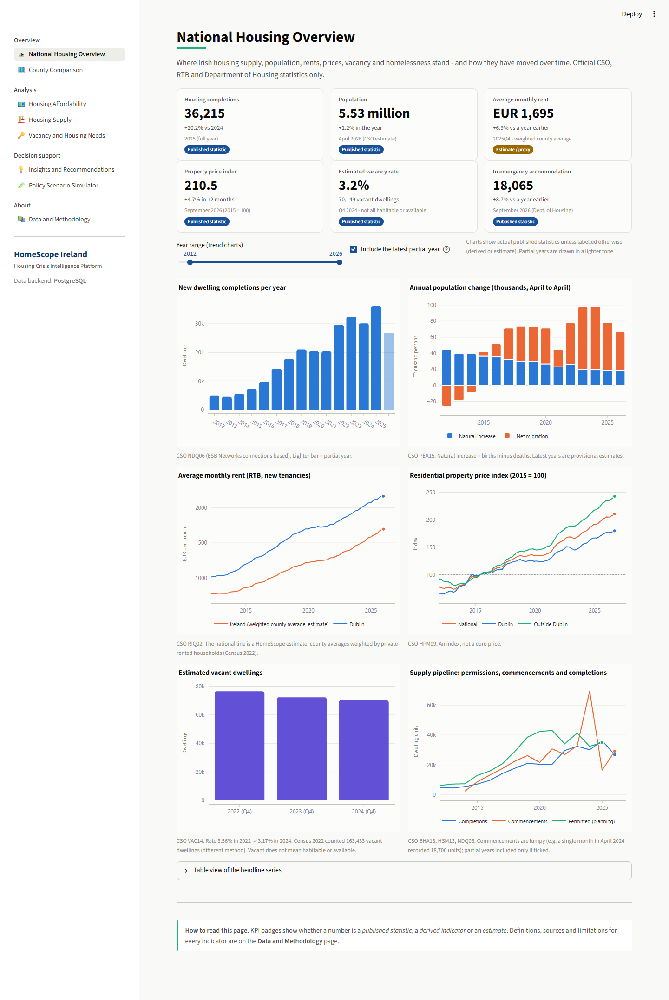
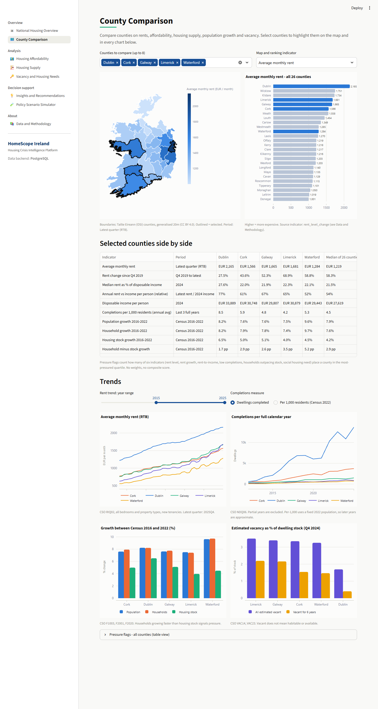
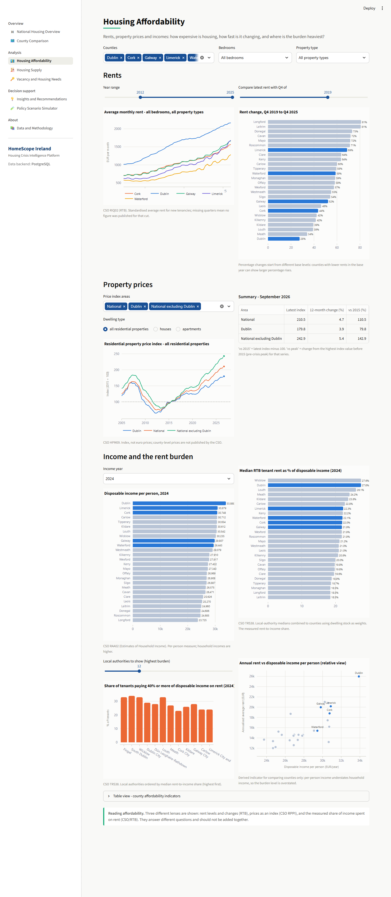
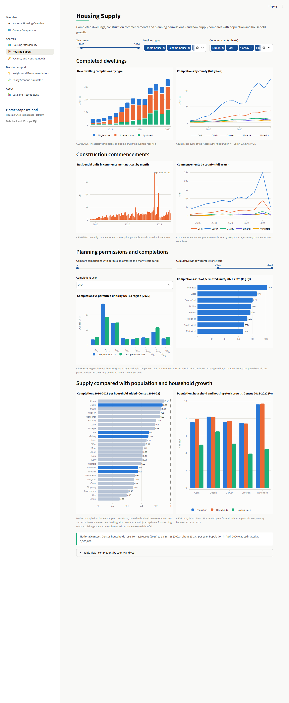
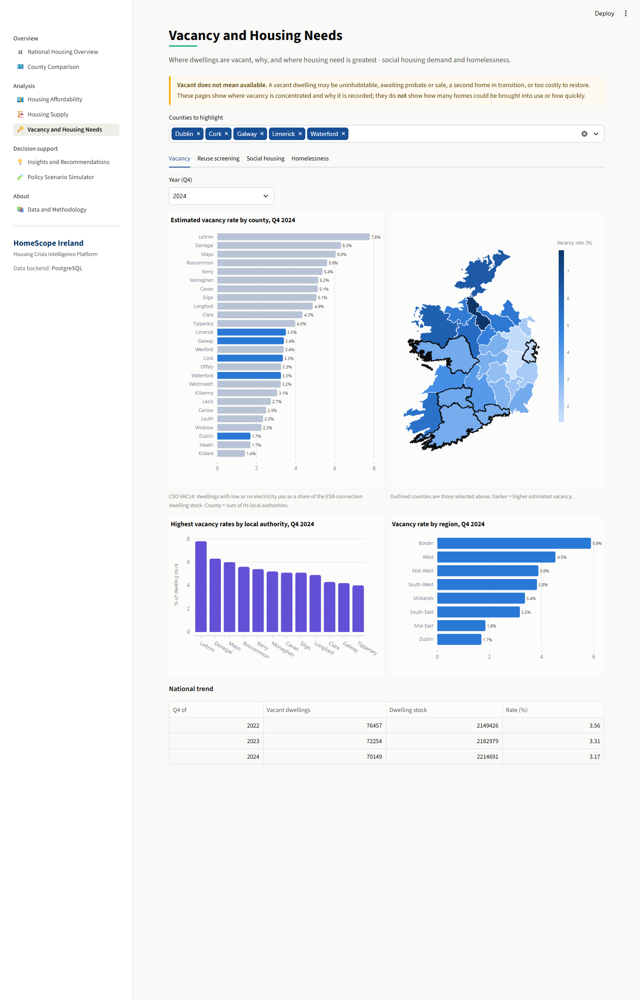
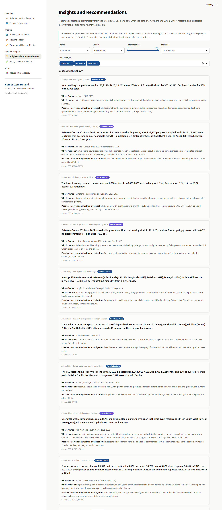
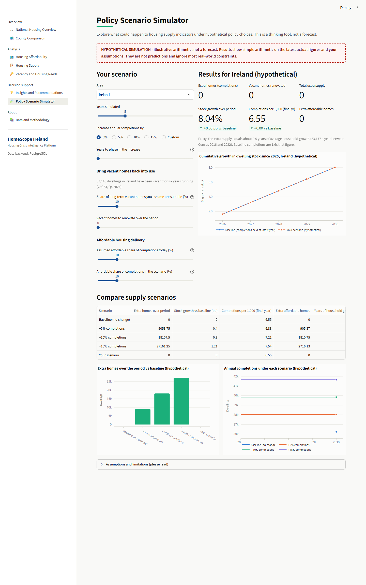
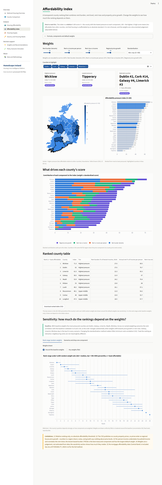

# HomeScope Ireland
### Housing Crisis Intelligence Platform

An end-to-end analytics project that collects **official Irish housing statistics**, cleans and validates them, loads them into **PostgreSQL**, analyses them with **SQL and Python**, and presents the evidence in an interactive **Streamlit** dashboard with a transparent policy scenario simulator.

> **What this is, and is not.** HomeScope Ireland provides reliable evidence, identifies patterns and helps people ask better questions about housing supply, affordability, vacancy and need. A dashboard cannot solve the housing crisis, and nothing here is a forecast or a policy prescription. Simulated results are always labelled **hypothetical**.



---

## 1. Project overview

HomeScope Ireland answers eight practical questions with real data:

1. Which counties have the greatest housing pressure?
2. Where is accommodation becoming increasingly unaffordable?
3. Is housing supply keeping up with population and household growth?
4. Where are vacant properties concentrated?
5. Are planning permissions translating into completed homes?
6. Which areas have greater social housing requirements?
7. Where could existing housing resources potentially be used more effectively?
8. Which interventions could make the greatest difference to housing availability? *(explored through the hypothetical simulator, not answered definitively)*

It is built to be read by policymakers, local authorities, researchers and communities, and to demonstrate production-quality analytics engineering: reproducible data collection, documented cleaning, a relational model, tested SQL and indicators, and a polished BI front end.

## 2. The housing problem being investigated

Ireland has had rapidly rising rents and prices, record homelessness and persistent regional differences in supply, while completions recovered only slowly after the 2008 crash. Understanding the crisis needs several lenses at once - supply, demand, affordability, vacancy, social need - measured consistently by geography and period. Official statistics exist for each, but they are published by different bodies, at different geographies and in different periods. This project joins them, states every assumption, and shows where the data can and cannot answer a question.

## 3. Objectives

* Build a reproducible pipeline from official sources to a decision-support application.
* Keep raw data untouched, document every cleaning decision, and reconcile to published totals.
* Provide transparent indicators (no arbitrary scores) with sources, periods, assumptions and limitations.
* Separate **published statistics**, **derived indicators**, **estimates** and **hypothetical scenarios** everywhere they appear.
* Be honest about limitations (e.g. *vacant is not the same as available*).

## 4. Technology stack

| Area | Tools |
|---|---|
| Language | Python 3.11, SQL |
| Data analysis | pandas, NumPy, scikit-learn (reserved for Phase 2 forecasting) |
| Database | PostgreSQL 16 (Docker Compose), SQLAlchemy, psycopg2 |
| Visualisation | Streamlit, Plotly (Matplotlib available for notebooks) |
| Quality | pytest (140 tests), Git, GitHub |
| Packaging | Docker / Docker Compose |

## 5. Architecture

```
Official APIs (CSO PxStat, data.gov.ie, Tailte Eireann)
        │  src/data_collection      download + provenance manifest, structure validation
        ▼
data/raw  (never modified)  ──►  src/data_cleaning   standardise, reconcile, quality report
                                        │
                                        ▼
                               data/processed (tidy CSVs)  ──►  src/database.loader ──► PostgreSQL
                                        │                                                   │
                                        └──────────────►  src/database.repository  ◄────────┘
                                                                  │   (PostgreSQL when reachable, CSV otherwise)
                         src/indicators  ·  src/analysis (insights, scenarios)
                                                                  │
                                                         dashboard (Streamlit, 9 pages)
```

```
HomeScope-Ireland/
├── data/raw | processed | sample     raw downloads + MANIFEST.json, tidy tables, small samples
├── database/                         schema.sql, seed_data.sql, queries.sql (20 queries)
├── src/
│   ├── data_collection/              sources registry, downloader, loaders/validators, catalogue
│   ├── data_cleaning/                reference data, cleaners, quality report, pipeline
│   ├── database/                     connection, loader, repository, query runner, seed generator
│   ├── indicators/                   calculations, county scorecard, documented registry
│   ├── analysis/                     insights generator, scenario simulator
│   ├── visualisation/ · utils/       (shared helpers / paths, logging, ITM->WGS84 conversion)
├── dashboard/                        app.py, views/ (9 pages), components/ (theme, charts, data)
├── tests/                            140 tests
├── docs/                             DATA_CATALOGUE, DATA_QUALITY, INDICATORS, AFFORDABILITY_INDEX, SQL_RESULTS
├── screenshots/ · notebooks/ · scripts/
└── Dockerfile · docker-compose.yml · requirements*.txt · .env.example
```

## 6. Data sources

All data are official open data downloaded through documented APIs (no scraping). Full table with publication dates and reference periods: **[docs/DATA_CATALOGUE.md](docs/DATA_CATALOGUE.md)**.

| Publisher | Datasets used | Licence |
|---|---|---|
| [CSO Ireland](https://www.cso.ie/) via [PxStat](https://data.cso.ie/) | New dwelling completions (NDQ06), commencement notices (HSM13), planning permissions (BHA13), Census population / households / housing stock / tenure / vacancy (F1003, F2001, F2020, F2004, F2014), vacancy estimates (VAC14, VAC23), RTB average rents (RIQ02), Residential Property Price Index (HPM09), household income by county (RAA02), RTB rent-to-income (TRS38), social housing need (SCA10), population estimates (PEA01, PEA15) | CC BY 4.0 |
| [Dept. of Housing, Local Government and Heritage](https://www.gov.ie/en/department-of-housing-local-government-and-heritage/) via data.gov.ie | 90 monthly Homelessness Reports (Jan 2019 - Sep 2026) | CC BY-SA 4.0 |
| Tailte Eireann (formerly OSi) | County boundaries, generalised 20m | Open data (CC BY 4.0) |
| [RTB](https://www.rtb.ie/research) | Rents (RIQ02) and tenant rent-to-income (TRS38) are published by the CSO from RTB data | CC BY 4.0 |
| Central Bank of Ireland | **Not used in Phase 1.** Mortgage-lending and affordability data are listed under future work | - |

## 7. Dataset descriptions

| Theme | Table (processed) | Grain | Latest period |
|---|---|---|---|
| Supply | `completions_quarterly` | local authority x quarter x dwelling type | 2026 Q3 (2026 partial) |
| Supply | `commencements_monthly` | local authority x month | Oct 2026 |
| Supply | `planning_permissions` (+ `_national`) | NUTS3 region x year (regional from 2018); national from 1975 | 2025 |
| Demand | `population_census`, `households_census` | county x Census year | April 2022 |
| Demand | `population_national` | State x year | April 2026 |
| Stock / vacancy | `housing_stock_census`, `vacancy_estimates`, `long_term_vacancy`, `vacancy_reasons_census` | Census area / local authority | Census 2022; Q4 2024 |
| Affordability | `rents_rtb`, `property_price_index`, `household_income_county`, `rent_to_income_la` | county / index area | Q4 2025; Sep 2026; 2024 |
| Social | `tenure_census`, `social_housing_need` | county | Census 2022; 2024 |
| Homelessness | `homelessness_monthly` | Dept. region x month | Sep 2026 |

## 8. Data-cleaning methodology

* **Raw files are never modified** (checksums in `data/raw/MANIFEST.json`; a test re-verifies them).
* **No imputation** of official statistics: blank/suppressed values stay missing, and absent rent cells are dropped, never zero-filled.
* **Standardised geography**: 26 counties, 31 local authorities (Dublin = 4, Cork = 2, Galway = 2), NUTS3 regions (matching CSO table CIRGDP07) and the Department's 9 homeless regions.
* **Reconciliation**: the sum of parts is compared with the published national total for completions, commencements, planning, population, households, stock, tenure, vacancy reasons, social need, income.
* **Duplicates** keep the first record and are reported; **ranges** are validated; **periods** are labelled and partial years flagged.
* **Issues found and fixed during the build** (all visible in the quality report): thousands separators (`4,258`) in the 2019/2021 homelessness files silently turning into missing values (caught by a month-on-month anomaly check, now parsed and tested); OSi boundaries published in ITM metres converted to WGS84; planning data split by dwelling type only from 2018; SCA10 county values missing for several years.
* Every check (87) is listed in **[docs/DATA_QUALITY.md](docs/DATA_QUALITY.md)** - currently 0 warnings.

## 9. Database structure

`database/schema.sql`: dimensions `dim_region`, `dim_county`, `dim_local_authority`; provenance table `data_source`; 19 fact tables (completions, commencements, planning, population, households, housing stock, tenure, vacancy, long-term vacancy, vacancy reasons, rents, property prices, income, rent-to-income, social need, homelessness...); primary keys on every table, foreign keys to dimensions, `CHECK` constraints (quarter 1-4, counts >= 0, valid dwelling types), indexes on common filters and two views. Reference data are seeded by a generated `seed_data.sql` that a test keeps identical to the Python reference module.

## 10. SQL analysis

20 documented queries in **[database/queries.sql](database/queries.sql)** (JOINs, CTEs, `CASE`, window functions - `RANK`, `NTILE`, `LAG`, running `MAX`, rolling averages - `FILTER` aggregation, scalar subqueries, date-based self-joins). Each states the question it answers. Snapshot of outputs: **[docs/SQL_RESULTS.md](docs/SQL_RESULTS.md)**. Examples: completions by county/year and share of national output; households vs housing-stock growth; rent change since 2019; property-price drawdown from the previous peak; planning permissions vs completions with a 2-year lag; vacancy by region and long-term share; Census vacancy reasons grouped by possible reuse pathway; rent-to-income by county; homelessness per 10,000 residents. Run them with `python -m src.database.run_queries`.

## 11. KPI definitions

Every indicator has a documented calculation, source data, reference period, assumptions and limitations in **[docs/INDICATORS.md](docs/INDICATORS.md)** (also in the app). Highlights:

| Indicator | Definition |
|---|---|
| Total completions / annual supply growth | Sum of NDQ06 completions; year-on-year change between two **full** years only |
| Completions per 1,000 residents | Average annual completions over the last 3 full years / Census 2022 population x 1,000 |
| Household vs stock growth | Household growth % minus housing-stock growth %, Census 2016 to 2022 (percentage points) |
| Rent level and change | RTB standardised average monthly rent for new tenancies; change vs Q4 2019 |
| Rent-to-income (measured) | Median RTB tenant rent as % of that tenant's disposable income (CSO TRS38), county = stock-weighted local authorities |
| Planning-to-completion comparison | Completions in year Y / units permitted in Y minus lag (NUTS3 region) - a comparison ratio, *not* a conversion rate |
| Vacancy rate | Vacant dwellings / dwelling stock, summed from local-authority counts - *vacant is not available* |
| County pressure flags | Count (0-6) of six indicators in which a county is in the most-pressured quartile. **No weights, no composite score** |
| **Affordability Pressure Index** (Phase 2) | Relative 0-100 county ranking: weighted average of four min-max standardised components (tenant rent burden 35%, rent vs income 25%, rent rise vs income 20%, regional house-price growth 20%). Weights are adjustable in the app and a sensitivity analysis shows how much rankings depend on them. Full method: **[docs/AFFORDABILITY_INDEX.md](docs/AFFORDABILITY_INDEX.md)** |

## 12. Dashboard screenshots

| | |
|---|---|
|  |  |
| County Comparison - interactive OSi county map | Housing Affordability |
|  |  |
| Housing Supply | Vacancy and Housing Needs |
|  |  |
| Insights and Recommendations | Policy Scenario Simulator (hypothetical) |
|  | |
| Affordability Index (Phase 2): adjustable weights, map, sensitivity analysis | |

Pages: National Housing Overview, County Comparison, Housing Affordability, **Affordability Index (Phase 2)**, Housing Supply, Vacancy and Housing Needs, Insights and Recommendations, Policy Scenario Simulator, Data and Methodology. Filters cover county, year, period, indicator, bedrooms, property type, dwelling type and planning lag.

## 13. Actual findings

Generated from the loaded data (also shown, with why-it-matters and next steps, in the app). Figures are as of the latest data in this repository (November 2026):

* **Supply recovered strongly:** 36,215 completions in 2025 (+20.2% on 2024; 7.9x the 2013 low); Dublin was 38% of the total.
* **Supply vs need (proxy):** completions in 2025 were 1.6x the average annual household growth of 2016-2022 (about 23,177 households a year) - but population has grown faster since Census 2022, and accumulated shortfall is not measured.
* **Households outgrew housing stock in all 26 counties** between Census 2016 and 2022 (largest gaps: Leitrim, Roscommon, Sligo).
* **Lowest building relative to population (2023-25):** Longford 2.4, Roscommon 2.9, Leitrim 3.2 completions per 1,000 residents a year vs 6.4 nationally.
* **Rents:** the biggest rises since Q4 2019 were Longford (+81%), Leitrim (+81%) and Donegal (+73%); Dublin is highest (EUR 2,165) but rose 28% from a higher base.
* **Rent burden:** median tenants spent most of their income on rent in Fingal (28.5%), South Dublin (28.2%) and Wicklow (27.6%); 34% of South Dublin tenants paid 40%+.
* **Prices:** the CSO price index is 210.5 (2015 = 100), +4.7% in 12 months and 29% above its pre-crisis peak.
* **Planning vs completions:** 2021-2025 completions equalled only 67-68% of permitted units in the Mid-West and South-West regions.
* **Commencements are lumpy:** 69,311 units in 2024 (18,700 in April 2024 alone) vs 16,412 in 2025 - read multi-year averages, not single years.
* **Vacancy:** highest in Leitrim (7.8%), Donegal (6.3%) and Mayo (6.0%) vs 3.2% nationally; 53% of vacant dwellings have been vacant six years running, and those counties are lower-rent - so reusing vacant homes would not automatically relieve the most pressured areas.
* **Reasons for vacancy (Census 2022):** 31% of vacant dwellings were vacant for renovation or because the owner had died - a screening signal, not proof that a home can be reused.
* **Homelessness:** 18,065 people in emergency accommodation in September 2026 (+8.7% year on year; 9,987 in January 2019); 69% in the Dublin region.
* **Pressure:** Limerick is in the most-pressured quartile on 4 of the 6 indicators.

## 14. Limitations

* **Vacant is not available.** Vacancy figures are estimates or Census-night snapshots; they say nothing about habitability or the cost of restoring a home.
* **Completions are a proxy** (ESB new connections); the latest year (2026) is partial and never used for year-on-year change.
* **Geography varies:** planning data are regional (from 2018), homelessness is by Department region, prices are an index with no county euro prices.
* **Different reference periods** (Census 2016/2022, vacancy Q4 2022-24, rents to Q4 2025, prices and homelessness to Sep 2026, income 2024) are labelled, not harmonised away.
* **Gaps:** three months of homelessness reports (Jun-Aug 2023) are absent from the open-data portal; SCA10 has county values only for some years; some RTB cells are unpublished.
* **Social housing coverage is partial:** families with children identified as in need (not the full waiting list) and Census tenure; no recent delivery data.
* **Affordability:** measured rent-to-income uses individual tenant income; the per-person county view overstates burdens and is for comparison only; no mortgage-affordability data.
* **Simulator** is arithmetic on stated assumptions - not a forecast, ignores demand, prices, migration and delivery constraints.
* **GitHub/Docker/environment notes** are in PROGRESS.md.

## 15. Installation

Requirements: Python 3.11+, Docker (for PostgreSQL), Git.

```bash
git clone https://github.com/TanviC1314/HomeScope-Ireland.git
cd HomeScope-Ireland
python -m venv .venv
.venv\Scripts\activate            # Windows   (macOS/Linux: source .venv/bin/activate)
pip install -r requirements-dev.txt
cp .env.example .env              # then set POSTGRES_PASSWORD (and the same password in DATABASE_URL)
```

## 16. Database setup

```bash
docker compose up -d db                       # PostgreSQL 16 on localhost:5433
python -m src.data_collection.downloader      # download raw data (skips files already present)
python -m src.data_cleaning.pipeline          # clean -> data/processed, quality report
python -m src.database.loader --reset         # create schema, seed dimensions, load all facts
python -m src.database.run_queries            # execute the 20 SQL queries
```

Port 5433 avoids clashing with a PostgreSQL already on 5432. Two large raw files (`F2004`, `RIQ02`) are not committed; the downloader regenerates them and verifies their provenance. If an automated download fails, `data/raw/MANIFEST.json` records manual download instructions for that dataset. Without Docker, the dashboard still runs from the committed processed CSVs.

## 17. Running the application

```bash
streamlit run dashboard/app.py                # http://localhost:8501
pytest                                        # 113 tests (PostgreSQL tests skip if the DB is down)
docker compose up -d --build                  # database + dashboard in containers
```

Set `HOMESCOPE_DATA_BACKEND=csv|postgres|auto` to choose the data source (default `auto`: PostgreSQL when reachable, otherwise CSV).

## 18. Future enhancements

Phase 2 progress (see **[FUTURE_ENHANCEMENTS.md](FUTURE_ENHANCEMENTS.md)**): Day 2 advanced affordability index is **done**. Still planned: Day 3 supply-demand gap; Day 4 price forecasting; Day 5 vacancy reuse opportunity analysis; Day 6 advanced housing map; Day 7 automated pipeline and monthly reporting.

---

*Contains public sector information licensed under CC BY 4.0 (CSO, Tailte Eireann) and CC BY-SA 4.0 (Department of Housing, Local Government and Heritage). This project is not affiliated with those bodies.*
